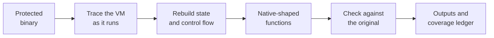

  <a href="https://devirt.re">
    <picture>
      <source media="(prefers-color-scheme: dark)" srcset="https://raw.githubusercontent.com/Devirt-re/.github/main/profile/devirt-hero-dark.svg">
      
    </picture>
  </a>

  
  
  
  
  
  

## Binary devirtualization and reverse engineering

**Devirt (devirt.re) is a binary devirtualization and reverse engineering service for security researchers and malware analysts.** Protectors such as VMProtect and Themida hide a program's logic inside a private virtual machine. Devirt follows the protected program as it runs, reconstructs the virtual machine's state and control flow, converts that behavior into native-shaped functions and checks them against the original. Customers choose the output they need: an IDA database, annotated pseudocode, a reverse engineering report, LLVM IR or structured JSON.

## How Devirt works

Devirt checks recovered code in three ways:

1. **Solver check.** A solver searches for a counterexample within a declared model. UNSAT supports equivalence within that model, SAT identifies a disagreement, and a timeout leaves the comparison unresolved.
2. **Differential check.** Recovered operations are translated to LLVM IR and compared with the original observations and with native execution for selected inputs.
3. **IDA persistence check.** For IDA output, Devirt saves the database and reopens it to confirm that named functions and typed calls persist.

Read more on [how Devirt works](https://devirt.re/how-it-works).

## Devirtualization and analysis services

| Service | What it covers |
|---|---|
| [VMProtect devirtualization](https://devirt.re/vmprotect-devirtualization) | An IDA database, annotated pseudocode and a coverage ledger for every protected function |
| [Themida devirtualization](https://devirt.re/themida-devirtualization) | Limited recovery per file and broader scopes on subscription, with a coverage ledger on every result |
| [Enigma Protector devirtualization](https://devirt.re/enigma-protector-devirtualization) | Code recovered from the Enigma Protector virtual machine, delivered as an IDA database with a per-function coverage ledger |
| [Obsidium devirtualization](https://devirt.re/obsidium-devirtualization) | Code recovered from the Obsidium virtual CPU, delivered as an IDA database with a per-function coverage ledger |
| [Loki VM devirtualization](https://devirt.re/loki-vm-devirtualization) | Analysis for Obfuscator X, Griffin and other Loki derivatives, with a free assessment for every binary |
| [JavaScript VM deobfuscation](https://devirt.re/javascript-vm-deobfuscation) | Malicious scripts, front-end security reviews and research on code you are authorized to analyze |
| [Malware analysis service](https://devirt.re/malware-analysis-service) | Isolated analysis of protected or ordinary samples, a behavioral report and a coverage ledger |
| [Software reverse engineering](https://devirt.re/binary-reverse-engineering) | Readable logic and tool-ready outputs for protected and ordinary binaries |
| [Protected binary analysis](https://devirt.re/protected-binary-analysis) | Recovered logic and five output formats for packed, obfuscated and virtualized executables |
| [Anti-cheat driver auditing](https://devirt.re/anti-cheat-analysis) | Authorized audits of what kernel-level anti-cheat drivers monitor, collect and expose. Devirt never builds cheats. |
| [DRM architecture analysis](https://devirt.re/drm-analysis) | For rights holders and vendors reviewing their own protection design, and for authorized interoperability and compliance work |

All services: [devirt.re/services](https://devirt.re/services)

## Supported protectors

| Protection | How it starts |
|---|---|
| VMProtect, Themida, Code Virtualizer | Automated recovery, with eligibility confirmed for each exact build |
| Enigma Protector, Obsidium | A free assessment of every file, then a written offer |
| Loki-based virtual machines (including Obfuscator X and Griffin) | A free assessment of every binary, then a written offer |
| JavaScript virtual machines, .NET virtualizers, commercial packers, custom virtual machines | A free assessment of every file, then a written offer |

Devirt also analyzes ordinary, unprotected binaries. The current list is on [devirt.re/supported-protectors](https://devirt.re/supported-protectors).

## What a Devirt result contains

| Output | Who it is for |
|---|---|
| IDA database | Analysts who continue in IDA with named functions and typed calls |
| Annotated pseudocode | Readers who need the recovered logic without a disassembler |
| Reverse engineering report | Readers who need conclusions rather than code |
| LLVM IR | Compilers and analysis pipelines |
| Structured JSON | Automation and internal tooling |

Every recovery comes with a coverage ledger. It lists the code in scope and gives each function one of four outcomes, so analysts can see exactly where the evidence stops.

  <picture>
    <source media="(prefers-color-scheme: dark)" srcset="https://raw.githubusercontent.com/Devirt-re/.github/main/profile/devirt-ledger-dark.svg">
    
  </picture>

How to read a coverage figure: [devirt.re/research/devirtualization/coverage-is-a-contract](https://devirt.re/research/devirtualization/coverage-is-a-contract)

## Who uses Devirt

| Team | Typical work |
|---|---|
| [Reverse engineering consultancies](https://devirt.re/use-cases/reverse-engineering-consultancies) | Outsourcing the devirtualization when VM-protected functions stall a client engagement |
| [Malware analysts](https://devirt.re/use-cases/malware-analysts) | Recovering the logic that VM-protected malware hides from the decompiler |
| [Vulnerability researchers](https://devirt.re/use-cases/vulnerability-researchers) | Security research on VMProtect- or Themida-protected software within an authorized scope |
| [Software owners](https://devirt.re/use-cases/software-owners) | Recovering readable logic from a protected binary they own when the source is lost |
| [Interoperability teams](https://devirt.re/use-cases/interoperability-teams) | Recovering the protocol or file format a protected component hides |
| [Supply-chain security teams](https://devirt.re/use-cases/supply-chain-security-teams) | Seeing what a vendor's protected code does, beyond a list of components |
| [Trust and safety teams](https://devirt.re/use-cases/trust-and-safety-teams) | Triage of protected uploaded executables, with the analysis bounds stated |

All use cases: [devirt.re/use-cases](https://devirt.re/use-cases)

## Start free

- **Browser check:** reads a file's format and signs of protection on the device, without uploading it.
- **Community Triage:** a file inventory and protection indicators for a verified account.
- **Feasibility assessment:** a written scope, estimated coverage and quote for a complex file. Paid work begins only after the customer approves it. See a [sample assessment](https://devirt.re/assessment/sample).

Devirt accepts PE, ELF and Mach-O files up to 500 MiB through its web workspace or a [REST API](https://devirt.re/docs) with job status and webhooks. Prices are on [devirt.re/pricing](https://devirt.re/pricing).

## Research

- [Devirtualization methods](https://devirt.re/research/devirtualization): five method families, from handler analysis to LLVM lifting, and what each can prove
- [VMProtect research](https://devirt.re/research/vmprotect): how virtualization, mutation and Ultra mode work
- [Themida research](https://devirt.re/research/themida): how its virtual machines work and why antivirus tools flag protected files
- [Binary analysis research](https://devirt.re/research/binary-analysis): static and dynamic analysis, and what protection hides
- [Runtime-dependent, unresolved and bounded functions explained](https://devirt.re/research/devirtualization/runtime-dependent-functions)
- [Protected binary analysis workflow](https://devirt.re/blog/protected-binary-analysis-workflow)

## FAQ

<b>What is binary devirtualization?</b>

Protectors such as VMProtect and Themida replace a program's original instructions with bytecode that only the protector's own interpreter understands, so a disassembler or decompiler shows the interpreter instead of the program. Binary devirtualization recovers the logic that the virtual machine hides and turns it back into native-shaped functions an analyst can read.

<b>Is Devirt related to compiler devirtualization?</b>

No. Devirt (devirt.re) is not related to compiler devirtualization, the C++ optimization in GCC and LLVM that replaces virtual function calls with direct calls.

<b>Does Devirt return the original source code?</b>

No. Devirt returns inspectable logic, not the original source code, and a verified result applies to the declared scope and inputs rather than to every possible behavior of the program.

<b>Which files can Devirt analyze?</b>

Devirt only analyzes software that customers own or are authorized to examine, and it may decline a job or ask for clarification of scope or authorization. Eligibility is confirmed for each exact build, because a protector's name does not prove that a file can be recovered.

<b>What happens to uploaded files?</b>

Devirt processes each file in isolation and does not use customer files for model training. Input files are deleted after delivery.

## Find Devirt elsewhere

[Website](https://devirt.re) · [Medium](https://medium.com/@devirt) · [DEV Community](https://dev.to/devirt) · [SourceForge](https://sourceforge.net/software/product/Devirt/) · [Devpost](https://devpost.com/software/devirt) · [Quora](https://www.quora.com/profile/Devirt) · [Gravatar](https://gravatar.com/devirtre) · [Contact](https://devirt.re/contact)

---

Devirt only analyzes software that customers own or are authorized to examine.
